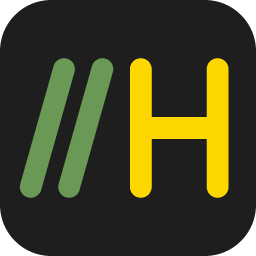
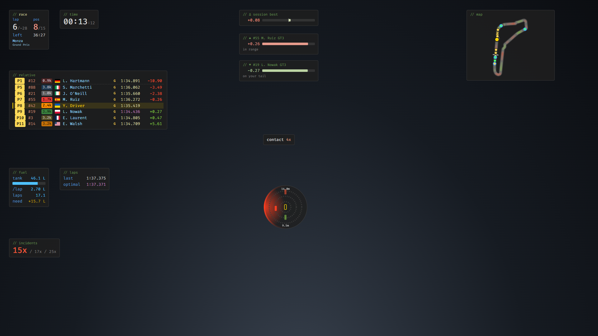

<p align="center"></p>

# HUDsplay

Personal, minimal iRacing HUD overlay. VS Code look, Fira Code, every color configurable.
Website: https://rusinovanton.github.io/hudsplay/ (source in `docs/`: live widgets from the
overlay's own CSS via `packaging/build_site.py`; this screenshot from
`uv run python packaging/capture_screenshots.py`). MIT licensed, see [LICENSE](LICENSE).



Widgets: session (lap / estimated total, position vs grid, time left), clock,
relative (cars ±3 on track + the leader, class and lap tags, iRating on a license-colored
badge, radio indicator; grid before the start, standings in practice/qualifying), fuel
(tank bar, per lap, laps left, needed to finish), laps (last + optimal), incidents
(count / next warning / DQ, alert), deltas (session best + gap and catch estimate for
the car ahead/behind), radar (cars alongside, three-wide warning), track map (recorded
on a clean lap or shipped, painted green/red by time gained/lost, overview or follow
mode). Color themes after popular VS Code themes, every color editable.

## Installer (recommended)

Run **`hudsplay-setup.exe`**. It installs HUDsplay for your user (no admin
needed), adds desktop + Start menu shortcuts, and starts it. Windows SmartScreen may
warn because the installer isn't code-signed: "More info" → "Run anyway".

- Runs in the **system tray** (gauge icon): edit mode, reload, start with Windows
  (on by default), open settings folder, quit.
- Settings (`config.toml`), recorded track maps and the log are in
  `%APPDATA%\HUDsplay\data` (tray → "Open settings folder"). Layout and colors from
  edit mode are kept in `%APPDATA%\HUDsplay`. Uninstalling keeps both.
- In iRacing: Options → Graphics → **Borderless windowed**, otherwise the overlay is hidden.

**Build the installer** (needs the dev setup below): double-click
**`build-installer.bat`** → `packaging\installer\hudsplay-setup.exe`. It
bundles the Python backend with PyInstaller (`hudsplay-backend.exe`) and the
overlay with electron-builder (NSIS). Bump `version` in `electron/package.json` for
a new release. The icon comes from `uv run python packaging/make_icon.py`.

**Release:** bump `version` in `electron/package.json`, commit, then push a tag
`v<version>` (`git tag v0.1.0 && git push origin v0.1.0`). GitHub Actions
(`.github/workflows/release.yml`) builds the installer on Windows and publishes it as a
release; the website's download button always points at the latest one.

## Dev setup on Windows (the iRacing PC)

1. Open **PowerShell** and install [uv](https://docs.astral.sh/uv/) (it also downloads Python):

   ```powershell
   powershell -ExecutionPolicy ByPass -c "irm https://astral.sh/uv/install.ps1 | iex"
   ```

2. Install Node.js LTS (runs the overlay window):

   ```powershell
   winget install OpenJS.NodeJS.LTS
   ```

   No winget? Use the LTS installer from https://nodejs.org.

3. **Close every open PowerShell / cmd window.** Windows that were already open
   don't see the new tools (`'uv' is not recognized`). If it persists, sign out of
   Windows and back in.
4. In iRacing: Options → Graphics → **Borderless windowed**. In fullscreen the
   overlay is hidden.
5. Get the code: `git clone git@github.com:RusinovAnton/hudsplay.git`, or download
   the zip and unpack it.

## Run

Double-click **`start.bat`**. The first run takes 1–2 minutes (Python, packages,
Electron download). It opens a backend console window and the overlay, which
shows up once you're in a session.

**Stuck at "Downloading Electron binary"?** It's ~110 MB with no progress bar, so
give it a few minutes. If it never finishes (antivirus, firewall, slow GitHub),
close the window and retry from a mirror in PowerShell, then run `start.bat` again:

```powershell
cd electron; $env:ELECTRON_MIRROR="https://npmmirror.com/mirrors/electron/"; node node_modules\electron\install.js
```

Manual start instead: `uv run hudsplay` in one terminal,
`cd electron && npm install && npm start` in another.

| Hotkey | Action |
| --- | --- |
| Ctrl+Shift+O | edit mode: click a widget for its settings, drag to move, mouse wheel to resize, show/hide, colors |
| Ctrl+Shift+R | reload overlay |
| Ctrl+Shift+Q | quit overlay |

The track map needs one clean lap per track/config to record its shape; after
that it's saved in `maps/`.

## Customize

- Layout, sizes, opacity, colors: edit mode (saved per machine). "copy css" →
  paste into `frontend/theme.css` to make colors the defaults. Palette buttons
  include color-blind-safe sets.
- Behaviour: create `config.toml` in the repo root (installed: `%APPDATA%\HUDsplay\data`):

```toml
[hudsplay]
standings_each_side = 3
standings_class_only = true
name_format = "short"   # or "full"
radar_range_m = 50   # max distance sent; view range is set in edit mode
delta_reference = "session_best"   # best | optimal | session_optimal | session_last
map_paint_reference = "session_last"   # same choices, for the map paint
map_mirror = false                 # flip a mirrored track map
```

## Preview without iRacing

Runs a fake race, on any OS (macOS too):

```bash
uv run hudsplay --mock
```

Open http://127.0.0.1:8765/ and press `e` for edit mode.

## Debug

```bat
uv run hudsplay --dump
```

Writes every telemetry var + session info YAML to `dump/irsdk_dump.txt`.

## Architecture

```
iRacing (shared memory, 60 Hz)
  -> src/hudsplay/sources/iracing.py   pyirsdk reader          (Windows only)
  -> src/hudsplay/engine.py            gaps, fuel, laps, radar (all derived logic)
  -> src/hudsplay/trackmap.py          track shape recording + delta paint
  -> src/hudsplay/server.py            aiohttp: serves frontend/, streams JSON on /ws
  -> frontend/                        HTML/CSS/JS widgets
  -> electron/                        transparent click-through window over the game
```

`--mock` swaps the iRacing source for a fake race (`sources/mock.py`) with the
same data shape, so the UI and engine can be developed on any OS.

## Privacy

HUDsplay doesn't collect, store or send any personal data or telemetry. It reads
iRacing's local telemetry on your PC and stays on your PC. The overlay downloads the
Fira Code web font from Google Fonts and country flag images from flagcdn.com; those
requests are plain file downloads that don't include anything about you or your
sessions. Settings, layout and recorded track maps are stored locally in
`%APPDATA%\HUDsplay`.
